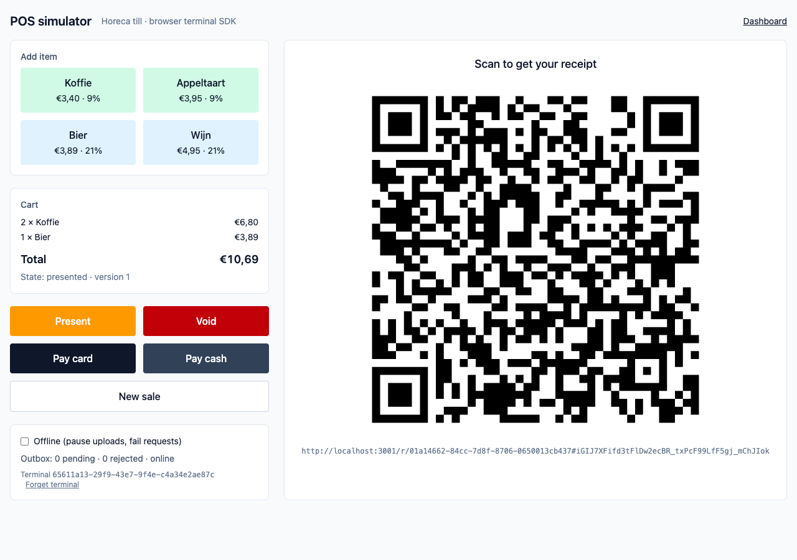
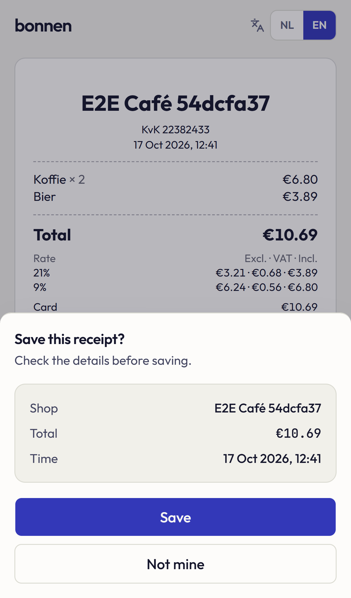
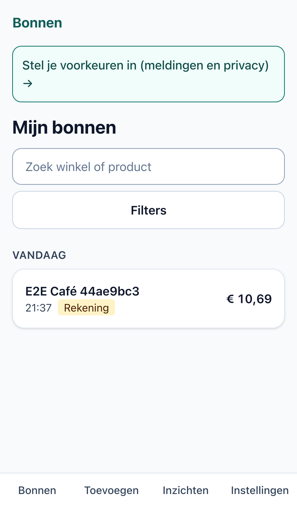
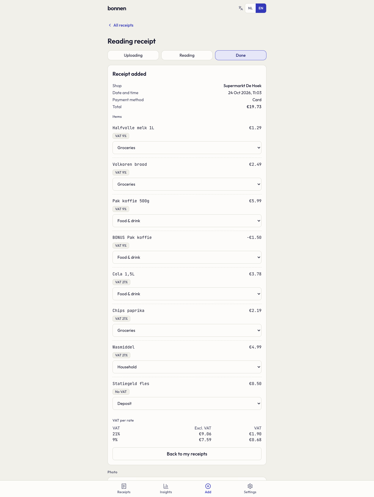
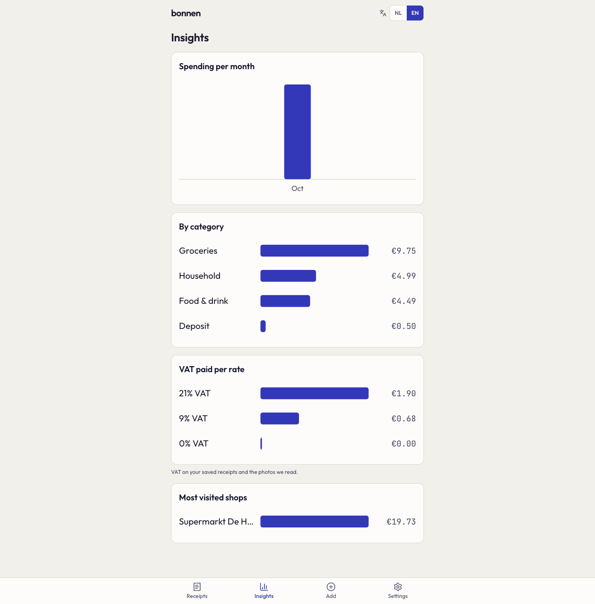
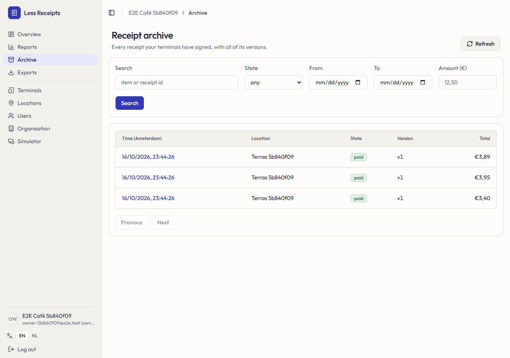
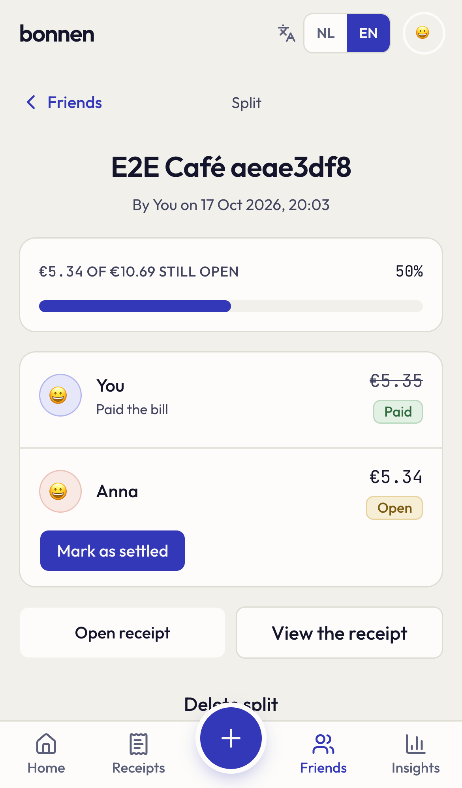

# Syngrapha: the receipt, without the paper

Every purchase still ends with a strip of thermal paper that nobody wants to keep and everybody needs later. Syngrapha replaces it with a digital receipt the buyer saves with one scan, while the shop learns nothing about who they are. A photo turns old paper receipts into the same tidy digital records.

> Want to run it or change it? See **[SETUP.md](SETUP.md)** (setup, configuration, architecture) and **[RUNNING.md](RUNNING.md)** (step-by-step demo).

## The problem with paper receipts

**They cost more than they look.**
- **Paper, water and carbon.** In the United States alone, receipts are estimated to use about 3.7 million trees and 10 billion gallons of water a year, and to emit as much carbon as about 471,000 cars ([Green America, *Skip the Slip*](https://reports.greenamerica.org/skip-the-slip)). The Netherlands prints them at every till too; there is no reason to think the picture is different, only smaller.
- **Shops pay for it.** Paper rolls, printer upkeep and the time spent changing rolls at a busy till, for a document most customers bin within minutes.

**They can harm the people who touch them.**
- Receipts are printed on thermal paper, which uses a chemical colour developer. The EU banned bisphenol A (BPA) above 0.02% in thermal paper from 2 January 2020 ([INERIS](https://substitution-bp.ineris.fr/en/news/restriction-bisphenol-thermal-papers)), and the industry largely moved to bisphenol S (BPS) instead: ECHA expected 61% of EU thermal paper to use BPS by 2022 ([ECHA](https://www.echa.europa.eu/-/bisphenol-s-has-replaced-bisphenol-a-in-thermal-paper)).
- ECHA lists bisphenols as substances that may interfere with hormones and affect reproduction, and is working on restricting the group ([ECHA, bisphenols](https://www.echa.europa.eu/hot-topics/bisphenols)). Cashiers handle these slips all day.

**They get lost exactly when you need them.**
- People say they throw away or lose about half (49%) of the paper receipts they get ([Green America](https://reports.greenamerica.org/skip-the-slip)).
- Thermal print fades with heat, light and time, so the receipt you kept is often unreadable by the time you need it for a return, a warranty claim, an insurance claim or an expense report.

**Today's "digital receipts" ask you to give yourself away.**
- Most e-receipts need an e-mail address, a loyalty card or an account with the shop. The receipt becomes a way to track you, which is why many people still ask for paper.

## The idea

A receipt that exists digitally from the moment you pay, that you can pick up with one scan, and that the shop cannot link to you.

1. **The till issues a digital receipt** and shows a QR code. It works even when the shop's internet is down.
2. **You scan it with your phone's camera.** The receipt opens; you check the shop, total and time and tap **Save**.
3. **It lives in your wallet:** searchable, with every line, the VAT per rate and the payment, ready for a return or an expense claim.

  
  
  

### Privacy by design
- The shop stores each receipt under **its own name only**. There is no field for the buyer, no e-mail, no loyalty number.
- The only link between you and a receipt is created when **you** tap Save, and it lives on the buyer side, which the shop's systems are technically unable to read.
- The code that proves the receipt is yours is part of the QR link but never reaches a server as part of a web address, and the wallet removes it from the address bar as soon as the page opens.

## Your old paper receipts, too

Paper will not disappear overnight. Take a photo of any Dutch receipt and the wallet:
- **prepares the photo on your phone** (finds the receipt, crops it, refuses blurry, dark or cut-off shots before anything is uploaded);
- **reads it** with Qianfan-OCR, an open vision model, and checks the result: it is only accepted when the lines, the total and the VAT per rate add up, otherwise you are asked to correct it;
- **sorts every line by type of expense** (groceries, food and drink, household, deposit, …) and **by VAT rate** (21%, 9%, 0%);
- **adds it to your insights**: spending per month, per category, VAT paid per rate and the shops you visit most.

  
  

## Who benefits

| | Benefit |
|---|---|
| **Buyers** | Every receipt in one place, readable forever: returns, warranties, insurance and expense claims without hunting for paper. Spending insights and VAT per rate, useful for freelancers. No account with the shop, no tracking. Split a receipt with friends and see who owes what. |
| **Shops** | No paper rolls and printer upkeep. A searchable archive of every receipt, reports, VAT exports for the accountant, and a receipt design in their own style. Works offline at the till. |
| **Cashiers** | Fewer thermal slips to handle all day. |
| **The planet** | Less paper, water and chemistry for a document most people throw away. |

  
  

## Where it stands

- **A working demo for the Netherlands:** Dutch VAT rules (21%, 9%, 0%, deposit, cash rounding), Dutch and English throughout.
- **Built and tested end to end:** the till, the wallet, the shop dashboard, photo reading, friends and splits, and a demo subscription for shops. Hundreds of automated tests and browser tests run on every change.
- **Not yet:** tapping the phone on an NFC sticker instead of scanning (designed for, not built), certified integration with official fiscal tills, and real payments (the shop subscription uses a demo payment page).
- **Honest limits:** photo reading has been tried on only a handful of real receipts, and it depends on a GPU server that is not always available. The main path, scanning the code at the till, does not depend on it.

---

Setup, configuration and technical details: **[SETUP.md](SETUP.md)** · Demo walkthrough: **[RUNNING.md](RUNNING.md)** · Design notes: [`docs/ARCHITECTURE.md`](docs/ARCHITECTURE.md), [`docs/DECISIONS.md`](docs/DECISIONS.md)
