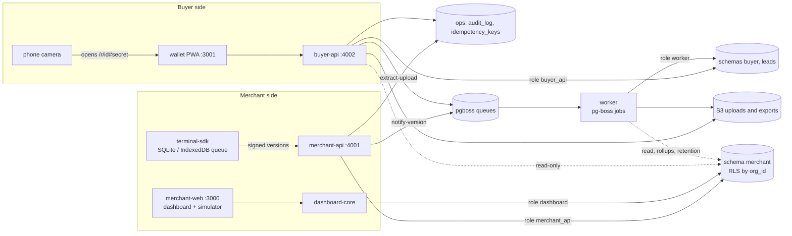
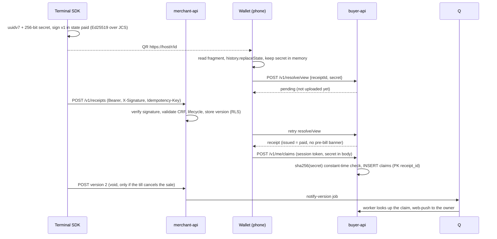
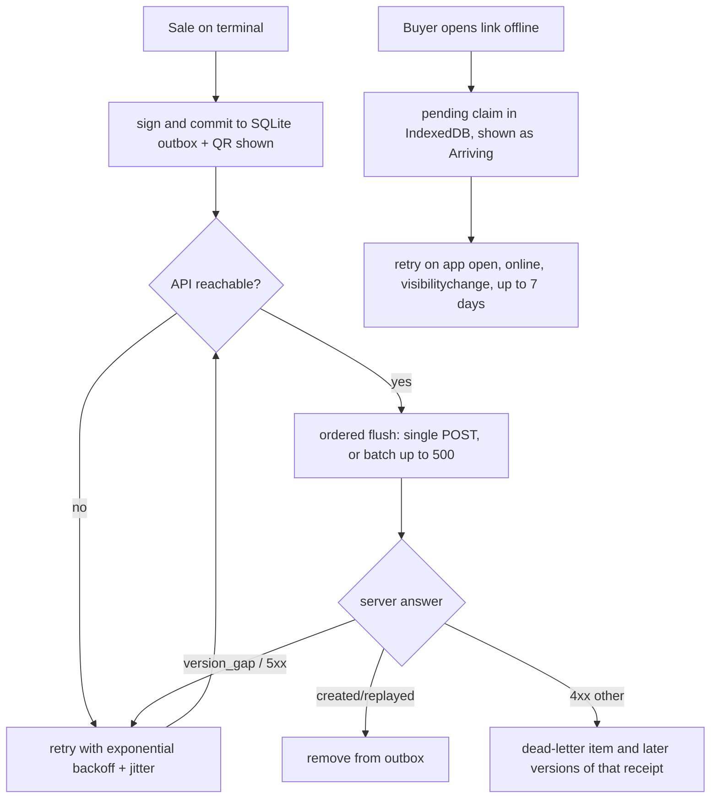
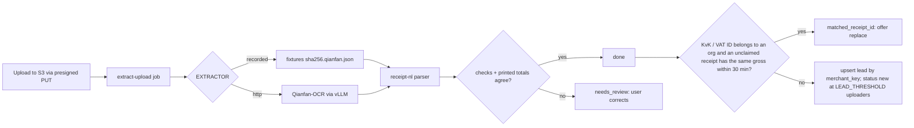

# Architecture

One Postgres 17 database split into schemas with separate roles. The merchant side and the buyer side never read each other's data. The only person ↔ receipt link is `buyer.claims`.

## Components and database roles

| Role | `merchant` | `buyer` | `leads` | `ops` |
| --- | --- | --- | --- | --- |
| `merchant_api` | read/write, RLS by org | none | none | audit insert, idempotency |
| `dashboard` | read/write, RLS by org (no receipt writes) | none | none | audit insert |
| `buyer_api` | read-only receipts, versions, location and organisation columns | read/write | read/write | audit insert |
| `worker` | read, plus rollups, lines, exports, retention deletes | read/write | read/write | audit insert |

`terminals` (key hashes, public keys) and `merchant_users` (password, TOTP) are unreachable from `buyer_api` and `worker`. Pre-auth lookups use three `SECURITY DEFINER` functions. See `docs/DECISIONS.md`.

## Golden path: QR to wallet

## Offline

## Photo extraction

